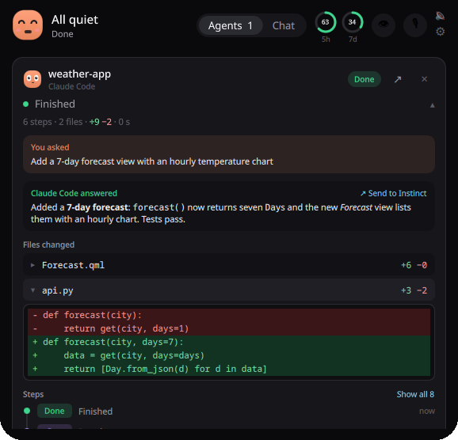
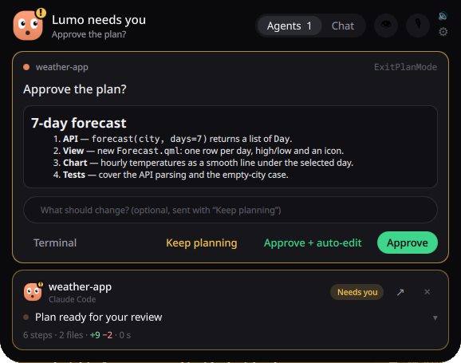
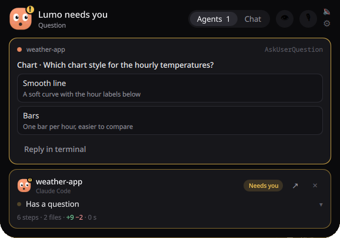
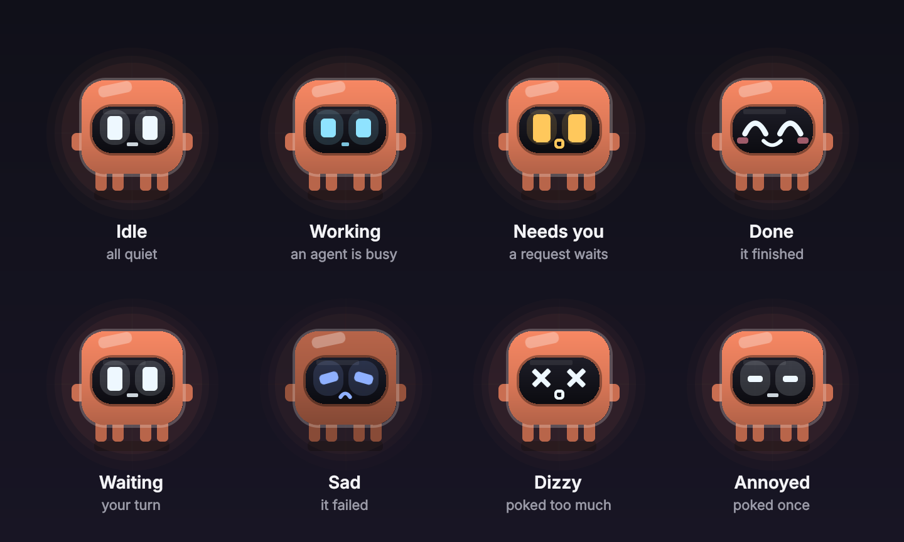
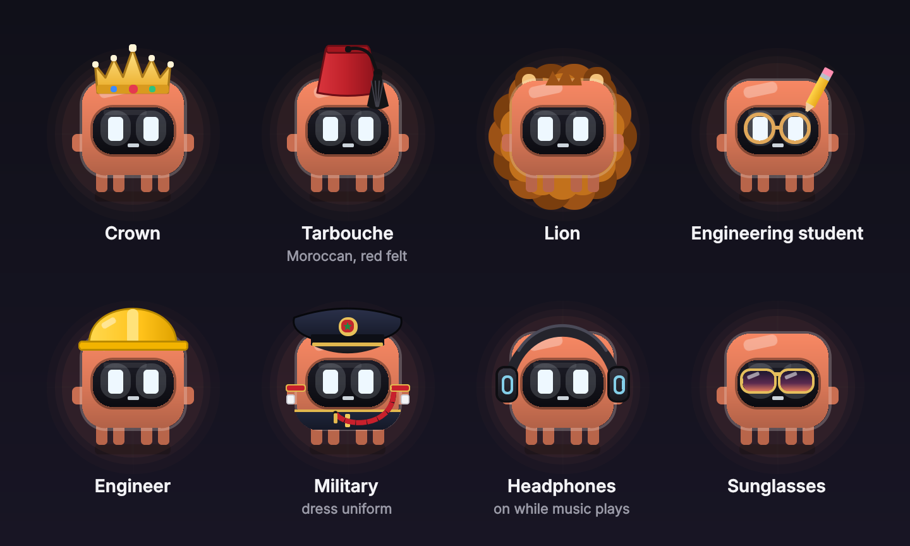

<div align="center">


# Lumo

### Your AI coding agents, at a glance.

**A tiny glowing friend at the top of your screen that watches over Claude Code — and calls you the moment it needs you.**

[](https://github.com/MoBENLAMINE/Lumo/actions/workflows/ci.yml)


[What it does](#what-it-does) · [Meet Lumo](#meet-lumo) · [Install](#install) · [Set up](#set-up) · [How it works](#how-it-works)

</div>

---

## Why Lumo

AI agents work in terminals you're not looking at. They finish while you're reading something else, and they stop
and wait for an answer you don't know they're asking for.

Lumo lives in a small island at the top centre of your screen, like a notch that comes alive. It shows what every
agent is doing, opens the moment one needs you, and lets you answer right there: approve a command, pick an answer,
read a plan, watch the diff. Then it gets out of your way.

It's native through and through: C++20 and Qt Quick, no web view. The island animates on the GPU, and it uses
**0 % CPU** while nothing happens.

## What it does



### Your agents, live

- **Every Claude Code session**: what it's doing now, what you asked, its answer, the files it changed (click for the
  diff) and a timeline of its steps. ↗ brings its terminal or editor forward. Codex, Gemini CLI and others can report
  too.
- **Approvals and questions**: Allow, Deny or Always (Claude Code's own "don't ask again"), or answer in the terminal.
  `AskUserQuestion` prompts, single or multiple choice, several at once.
- **Plans**: read Claude's plan in the island, then Approve, Approve + auto-accept edits, or Keep planning with your
  feedback.
- **Cloud sessions**: your sessions on claude.ai/code, working, needing you, done or failed. ↗ opens one in Claude
  Desktop. A switch in Settings turns the list off.

### Your voice, anywhere

- **Hold <kbd>Left Ctrl</kbd>, speak, let go**: the words are pasted where you type. Two taps for hands-free,
  <kbd>Esc</kbd> to cancel.
- **Offline**: [Parakeet v3](https://huggingface.co/nvidia/parakeet-tdt-0.6b-v3) in 25 languages through
  [sherpa-onnx](https://github.com/k2-fsa/sherpa-onnx), about 0.1 s per second of speech, on your computer.
- **Thoughtful**: speakers muted while it listens, your clipboard given back, your words always spelled your way,
  spoken shortcuts.
- **Your words, your way**: a dictionary, snippets (say a short phrase, paste a whole text), an optional clean-up by
  Claude on your plan (as said, natural or polished, per app), and statistics: words, time saved, days in a row,
  words a day and where you dictate.

### Claude, one hover away

- **Chat** with Claude on **your Pro or Max plan**, through the Claude Code CLI you're signed in to: no API key. Or
  a local Ollama model. Drop a file on the island to ask about it.
- **Notion**: chat about your Notion through your claude.ai connector, read-only unless you allow edits.
- **Plan usage**: your 5-hour and weekly Claude limits, as two rings in the island.

### A companion, not a notification

- **Lumo** reacts to everything: it works with your agents, calls you, celebrates, sulks, and gets dizzy if you poke
  it too much. Every reaction has its own synthesized sound.
- **It says hello** when it starts, and dances when music plays.
- **Your screen**: the island sits on the screen you pick, and goes back there when you plug it in again.
- **Music**: what's playing in any MPRIS player, with controls.
- **Instinct**: hands chat answers, sessions and dictations to the Instinct assistant through you (WhatsApp,
  pre-filled; you press Send).

<br clear="right">

<table>
<tr>
<td width="50%"></td>
<td width="50%"></td>
</tr>
<tr>
<td align="center"><sub>Read the plan, approve it or send it back</sub></td>
<td align="center"><sub>Answer Claude's questions without leaving your work</sub></td>
</tr>
</table>

<p align="center"><br><sub>While an agent works, the island stays small</sub></p>

## Meet Lumo

Lumo is a cousin of Claude's Clawd: a blocky little body in Claude's terracotta, two arms, four stubby legs, and a
glowing screen for a face. The light on that screen tells you how your agents are doing at a glance.

<p align="center"></p>

It has a wardrobe, too. Right-click Lumo in the island, or open Settings → General. **Auto** puts the headphones on
by themselves while music plays.

<p align="center"></p>

## Install

### Arch Linux / CachyOS

```bash
git clone https://github.com/MoBENLAMINE/Lumo.git
cd Lumo/packaging/arch && makepkg -si
```

### From source

Needs Qt ≥ 6.5 (Base, Declarative, Multimedia, ShaderTools), LayerShellQt, KF6 GlobalAccel, `wl-clipboard`, `pactl`,
and CMake, plus Qt's Linguist tools (`qt6-tools`) for the translations. The speech engine (sherpa-onnx) is downloaded
on first configure.

```bash
cmake -S . -B build -DCMAKE_INSTALL_PREFIX=$HOME/.local
cmake --build build -j
ctest --test-dir build --output-on-failure
cmake --install build
```

Then start **Lumo** from your app menu.

## Set up

1. **Claude Code**: Settings → Claude Code → *Connect…* shows the exact change to `~/.claude/settings.json`, makes a
   dated backup, and writes only when you click Apply. If Lumo isn't running, its hook exits at once: Claude Code is
   never held up.
2. **Dictation**: Settings → Dictation, download Parakeet (≈640 MB) or reuse an existing copy. Wayland lets no app
   see a lone <kbd>Ctrl</kbd>, so add yourself to the `input` group once and log in again:
   `sudo usermod -aG input $USER`. Without it, Lumo falls back to a desktop shortcut (<kbd>Ctrl+Alt+Space</kbd>).
3. **Chat**: sign in to the `claude` CLI; Lumo uses that login. For Notion, connect Notion at claude.ai → Settings →
   Connectors.

| Shortcut | |
|---|---|
| Hold <kbd>Left Ctrl</kbd> | Dictate (two taps: hands-free) |
| <kbd>Meta+Alt+N</kbd> | Open the chat |
| <kbd>Meta+Alt+I</kbd> | Show or hide the island |

## Privacy

No telemetry, no account. Lumo talks only to what you use: Anthropic (through the Claude Code CLI, its usage
endpoint, and the list of your cloud sessions, all with your Claude login; the cloud list can be switched off in
Settings → Claude Code), your local Ollama, the Notion connector of your Claude account, and GitHub once to
download the speech engine. Speech is recognized on your computer. Nothing is sent, published or approved without your
click.

## How it works

```
Claude Code ─hook─▶ lumo-hook (C, ~1 ms) ─$XDG_RUNTIME_DIR/lumo.sock─▶ HookServer ─▶ AgentHub ─▶ QML island
                        ▲                                                  │
                        └──────────── decision (Allow / Deny / answers) ◀──┘
```

A few rules hold everywhere:

- **Never block an agent.** No Lumo, no answer, or a timeout all mean silence, and Claude Code asks in its terminal
  as usual.
- **Nothing without your click.** Lumo never approves, sends or publishes on its own.
- **Quiet when idle.** Every looping animation stops while it isn't visible.

See [docs/ARCHITECTURE.md](docs/ARCHITECTURE.md) for the hook protocol, the Wayland layer-shell island, the
dictation pipeline and more. Want to help? Read [CONTRIBUTING.md](CONTRIBUTING.md).

## Credits

Inspired by [Coucou](https://github.com/Louis-CFM/coucou) by Louis Raillé. Lumo is an independent rewrite: no code,
character, sounds or icons come from Coucou. Lumo is a cousin of Claude's Clawd in spirit, drawn from scratch. Speech
recognition: NVIDIA Parakeet through k2-fsa's sherpa-onnx.

## License

[MIT](LICENSE) © 2026 Mohammed Benlamine
