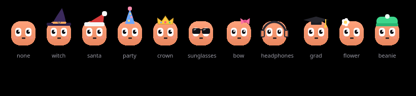

<div align="center">


# Lumo

**A tiny friend at the top of your screen that keeps an eye on your AI coding agents.**

Approve Claude Code's requests, answer its questions, read its plans, watch its diffs, chat on your Claude Pro plan,
and dictate anywhere by holding <kbd>Ctrl</kbd> — offline. Native, fast, and made for KDE Plasma on Wayland.

[](https://github.com/MoBENLAMINE/Lumo/actions/workflows/ci.yml)


</div>

## Why

AI agents work in terminals you're not looking at. Lumo sits at the top centre of your screen as a small island with a
character in it — also called Lumo — and tells you what your agents are doing, the moment they need you, and when
they're done. It's written from scratch in C++ and Qt Quick (no web view): the island animates on the GPU and uses
**0 % CPU** while nothing happens.

## Features

| | |
|---|---|
| **Agent sessions** | Every Claude Code session live: what it's doing now, what you asked, its answer, the files it changed (click for the diff) and a timeline of its steps. ↗ brings its terminal or editor window forward. Codex, Gemini CLI and others can report too. |
| **Approvals & questions** | Permission requests with Allow / Deny / Always (Claude Code's own "don't ask again"), or answer in the terminal. `AskUserQuestion` prompts — single or multiple choice, several at once. |
| **Plan approval** | Read Claude's plan in the island: Approve, Approve + auto-accept edits, or Keep planning with your feedback. |
| **Dictation** | Hold **Left Ctrl** alone, speak, let go — the words are pasted where you type. Offline [Parakeet v3](https://huggingface.co/nvidia/parakeet-tdt-0.6b-v3) (25 languages) via [sherpa-onnx](https://github.com/k2-fsa/sherpa-onnx), ~0.1 s per second of speech. Two taps for hands-free, Esc to cancel. Speakers muted while it listens, clipboard given back, your words always spelled your way, spoken shortcuts. |
| **Chat** | With Claude on **your Pro/Max subscription** through the Claude Code CLI you're signed in to — no API key — or a local Ollama model. Drop a file on the island to ask about it. |
| **Notion** | Chat with Claude about your Notion through your claude.ai Notion connector, read-only unless you allow edits. |
| **Plan usage** | Your 5-hour and weekly Claude limits, read from your Claude account. |
| **Music** | What's playing in any MPRIS player (Spotify, browsers, VLC…) with controls; Lumo dances. |
| **Lumo** | Blinks, follows your pointer, gets dizzy if you poke it too much, celebrates when an agent finishes, waves a "!" when it needs you — each with its own synthesized sound. Ten outfits, seasonal by default. |
| **Instinct** | Hands chat answers, sessions and dictations to the Instinct assistant through you (WhatsApp, pre-filled — you press Send). |

<table>
<tr>
<td width="50%"></td>
<td width="50%"></td>
</tr>
<tr>
<td></td>
<td></td>
</tr>
</table>

## Install

### Arch Linux / CachyOS

```bash
git clone https://github.com/MoBENLAMINE/Lumo.git
cd Lumo/packaging/arch && makepkg -si
```

### From source

Needs Qt ≥ 6.5 (Base, Declarative, Multimedia, ShaderTools), LayerShellQt, KF6 GlobalAccel, `wl-clipboard`, `pactl`,
and CMake. The speech engine (sherpa-onnx) is downloaded on first configure.

```bash
cmake -S . -B build -DCMAKE_INSTALL_PREFIX=$HOME/.local
cmake --build build -j
ctest --test-dir build --output-on-failure
cmake --install build
```

Then start **Lumo** from your app menu.

## Set up

1. **Claude Code** — Settings → Claude Code → *Connect…* shows the exact change to `~/.claude/settings.json`, makes a
   dated backup and writes only when you click Apply. If Lumo isn't running, its hook exits at once: Claude Code is
   never held up.
2. **Dictation** — Settings → Dictation: download Parakeet (≈640 MB) or reuse an existing copy. Wayland lets no app
   see a lone <kbd>Ctrl</kbd>, so add yourself to the `input` group once and log in again:
   `sudo usermod -aG input $USER`. Without it Lumo falls back to a desktop shortcut (<kbd>Ctrl+Alt+Space</kbd>).
3. **Chat** — sign in to the `claude` CLI; Lumo uses that login. For Notion, connect Notion at claude.ai → Settings →
   Connectors.

| Shortcut | |
|---|---|
| Hold <kbd>Left Ctrl</kbd> | Dictate (two taps: hands-free) |
| <kbd>Meta+Alt+N</kbd> | Open the chat |
| <kbd>Meta+Alt+I</kbd> | Show or hide the island |

## Privacy

No telemetry, no account. Lumo talks only to what you use: Anthropic (through the Claude Code CLI, and its usage
endpoint with your Claude login), your local Ollama, the Notion connector of your Claude account, and GitHub once to
download the speech engine. Speech is recognized on your computer. Nothing is sent, published or approved without your
click.

## How it works

```
Claude Code ─hook─▶ lumo-hook (C, ~1 ms) ─$XDG_RUNTIME_DIR/lumo.sock─▶ HookServer ─▶ AgentHub ─▶ QML island
                        ▲                                                  │
                        └──────────── decision (Allow / Deny / answers) ◀──┘
```

See [docs/ARCHITECTURE.md](docs/ARCHITECTURE.md) for the hook protocol, the Wayland layer-shell island, the
dictation pipeline and more.

## Credits

Inspired by [Coucou](https://github.com/Louis-CFM/coucou) by Louis Raillé. Lumo is an independent rewrite: no code,
character, sounds or icons come from Coucou. Speech recognition: NVIDIA Parakeet through k2-fsa's sherpa-onnx.

## License

[MIT](LICENSE) © 2026 Mohammed Benlamine
